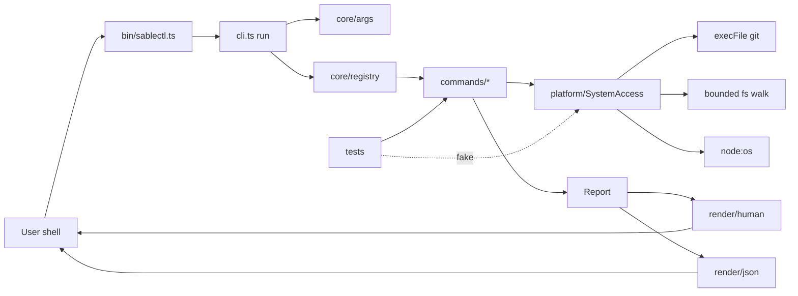

# Architecture

## The shape of it

Three layers, with a strict dependency direction:

```
commands/  →  core/  →  platform/
```

Only `platform/` touches the operating system. That single constraint is what makes everything else testable: a unit test injects a fake `SystemAccess` and asserts on the resulting check values, without mocking a module, spawning a process, or depending on what happens to be installed on the machine running the tests.



## The check abstraction

Everything the tool produces is a `CheckResult`:

```ts
interface CheckResult {
  id: string; // stable, machine-readable: 'node.version'
  title: string;
  status: 'pass' | 'warn' | 'fail' | 'info' | 'skip';
  summary: string; // always populated, never colour-dependent
  detail?: Record<string, unknown>; // the --json payload
  remediation?: string; // present whenever warn or fail
}
```

`env`, `git`, `inspect` and `validate` each produce a list of them; `doctor` is the union of the other four and owns no checks of its own. A check added to `validate` therefore appears in `doctor` automatically, and the two cannot report it differently. That is the whole extensibility story — no plugin system, no registry of registries.

Exit codes come from one pure function over the finished report (`exitCodeFor`), so no command can invent its own convention. `--strict` is expressed there too, once, rather than in each check.

## Why these decisions

**Zero runtime dependencies.** This is a tool people run on their own machines, often before they trust the project it is inspecting. Every dependency is supply-chain surface. The argument parser, the semantic-version comparison and the `.gitignore` matcher are each a few dozen lines, which is cheaper than the transitive tree that would replace them.

**Plain `tsc`, no bundler.** `dist/` is readable JavaScript that maps one-to-one onto the source. Someone auditing a CLI before running it can read what they are about to execute; a minified bundle makes that effectively impossible.

**Parse, never assert.** Manifests, TypeScript configuration, lockfiles, subprocess output and environment variables are all external data of unknown shape. `parse/` returns a discriminated `Parsed<T>`, so every caller must handle the malformed case. A `package.json` with `scripts: "build"` is a real thing; it produces a reported error, not a crash in an unrelated check.

**`execFile`, never `exec`.** All Git interaction passes an argument array with `shell: false`. Nothing derived from a branch name, a directory name or a remote URL is ever parsed by a shell, so injection is structurally impossible rather than something a filter must anticipate. The wrapper also sets a timeout, an output cap, and `GIT_TERMINAL_PROMPT=0` so a subprocess cannot block on a credential prompt, and `LC_ALL=C` so a translated message cannot silently change a parse.

**Version from the manifest.** `core/version.ts` walks up from its own module location to find the manifest. A literal would be a second source of truth, and it drifts the first time someone bumps one and forgets the other. A test reads `package.json` independently and compares, so a literal would fail the suite.

## Module map

| Path                  | Responsibility                                                          |
| --------------------- | ----------------------------------------------------------------------- |
| `bin/sablectl.ts`     | Owns the process and nothing else; delegates to `run`                   |
| `cli.ts`              | Parse, dispatch, render, map errors to exit codes                       |
| `core/args.ts`        | Flag and positional parsing, edit-distance suggestions                  |
| `core/check.ts`       | `CheckResult`, `Report`, severity ordering, exit-code derivation        |
| `core/registry.ts`    | The command table read by help, dispatch and the tests                  |
| `core/help.ts`        | Help text generated from the registry                                   |
| `core/project.ts`     | `--path` resolution with containment enforcement                        |
| `core/redact.ts`      | Credential redaction at the report boundary                             |
| `core/render/*`       | Human text, JSON envelope, colour decisions                             |
| `platform/system.ts`  | The real `SystemAccess`                                                 |
| `platform/process.ts` | `execFile` wrapper: no shell, timeout, output cap                       |
| `platform/fswalk.ts`  | Bounded, symlink-safe traversal                                         |
| `parse/*`             | Manifest, tsconfig, lockfile, semver, gitignore — all returning results |
| `commands/*`          | Thin: declare flags, select checks, return a report                     |

## Testing strategy

- **Unit** tests inject a fake `SystemAccess` and assert on statuses, summaries and exit codes.
- **Integration** tests create real temporary directories and real `git init` fixtures, and at least one drives the built binary as a child process so the actual entry point and actual exit codes are exercised.
- Tests assert on **outcomes**, never on whether a function was called. A test that only proves a function ran is a test that will keep passing after the behaviour breaks.

Coverage is reported but no numeric threshold is enforced: a percentage target rewards tests that execute code without asserting anything about it.
